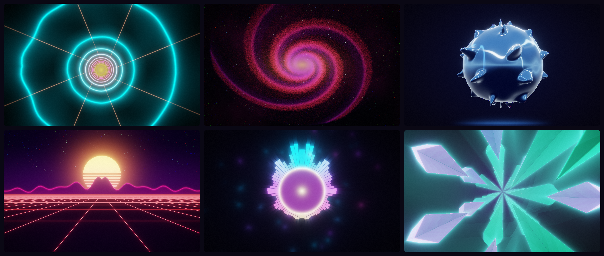
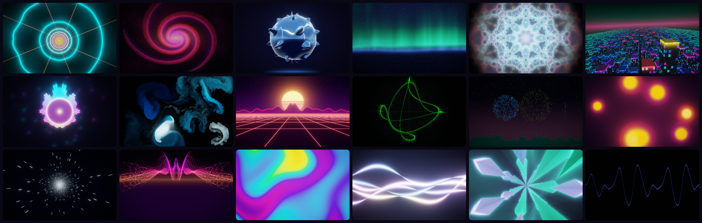
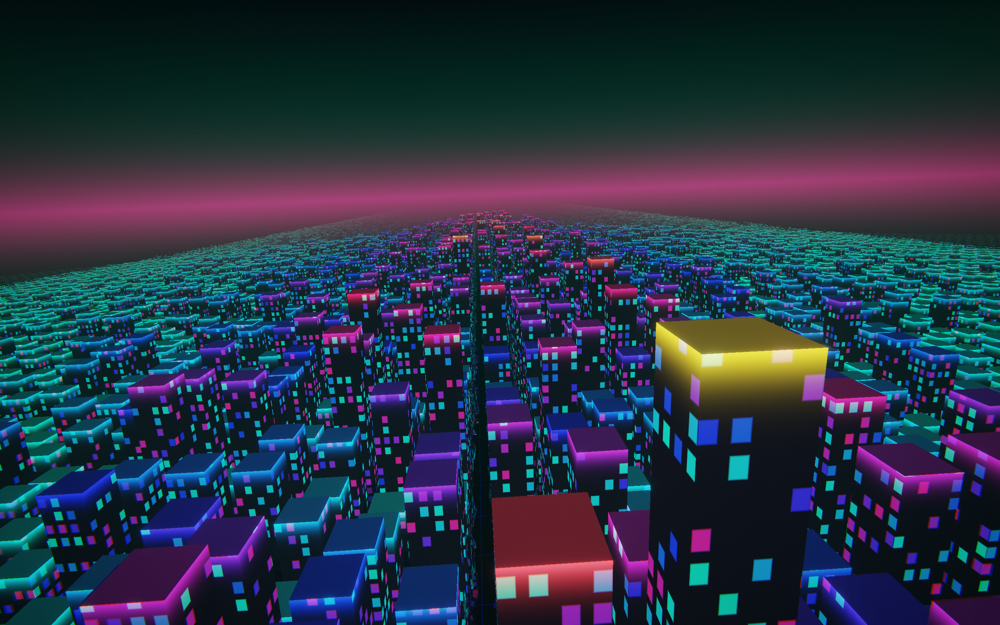
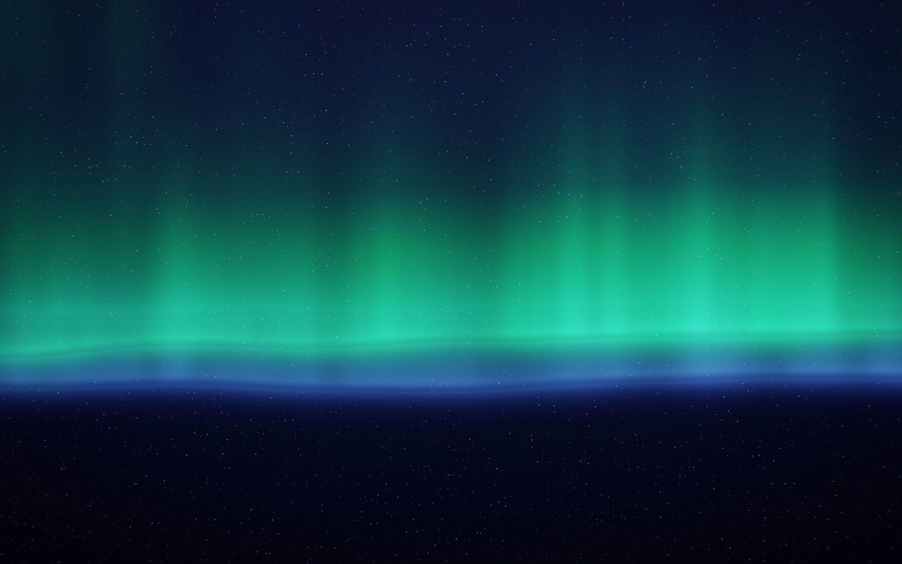

# Resonance

**A mesmerising music visualiser for your Mac.**
Resonance listens to whatever your Mac is playing and turns it into glowing visuals that move to the beat: in a window, fullscreen, as a live wallpaper, or as a see-through overlay on top of everything.

  

## Screenshots
| All 18 scenes | 3D Spectrum City | Aurora Waves |
| --- | --- | --- |
|  |  |  |

## Features
- **Hears everything.** Spotify, Music, YouTube, games: Resonance listens to your Mac's sound directly (or only the apps you pick, like just Spotify). A microphone or BlackHole works too.
- **Really on the beat.** It finds the tempo, the beats and the bars, sees build-ups coming and saves its biggest moments for the drop.
- **18 original scenes**: Neon Tunnel, Particle Galaxy (up to two million stars), Liquid Chrome, Aurora Waves, Kaleidoscope Bloom, 3D Spectrum City, Circular Spectrum, Ink Fluid, Synthwave Grid, Oscilloscope, Firework Beats, Lava Lamp, Warp Speed, Sound Terrain, Plasma Pulse, Ribbon Dance, Crystal Cave and Minimal Wave. Tweak each one in the Inspector and save presets.
- **Auto-VJ** switches scenes for you on drops or every 16, 32 or 64 bars, with transitions timed to the beat. **Shuffle** picks a new scene for every song.
- **Colours you'll love**: 16 palettes, an **Album Art** palette that matches the song's cover, your own gradients, and palettes that drift, cycle with the bars or flash on drops.
- **Play it anywhere**: a window, fullscreen on any display, a **live wallpaper** behind your windows, a **click-through overlay** on top (choose the opacity, blending and position), a floating **mini player**, a tiny spectrum in the menu bar, and a **screen saver**.
- **Song titles and controls** for Music and Spotify, with an elegant title card when a new song starts.
- **Capture**: ⌘S for a screenshot, ⌘R for a 10, 30 or 60-second MP4 clip with sound, up to 1080p60.
- **Safe and comfortable**: a photosensitivity warning on first launch and **Reduce Flashing on by default**. Reduce Motion is respected.
- Keyboard shortcuts for everything (press **?** to see them), light on energy (it stops completely when you can't see it), and a clean dark interface that fades away while you watch.

## Requirements
- A Mac with Apple Silicon (M1 or later)
- macOS 14 Sonoma or later (listening to system audio directly needs macOS 14.2 or later; older versions can use screen-capture audio or an input device)

## Install
1. [Download Resonance.dmg](https://github.com/MilkshakeSR/Resonance/releases/latest/download/Resonance.dmg) and open it.
2. Drag **Resonance** into **Applications**.
3. The first time, **right-click Resonance and choose Open**, then click **Open** again. Resonance isn't notarized by Apple, so macOS asks once.
4. When asked, allow **System Audio Recording** so Resonance can hear your music. The welcome screens show a live level meter so you can check it's working.

## Updates
Resonance checks for updates once a day and tells you when a new version is ready. You can also choose
**Resonance → Check for Updates…**, or turn on automatic installs in **Settings → Updates**.

## Privacy
Sound is analysed live on your Mac and is never recorded, saved or sent anywhere (unless you record a clip yourself, which is saved to your Pictures folder).
Your presets and settings stay on your Mac. There are no analytics or tracking.
What leaves your Mac: update checks go to GitHub, and if you use Spotify, the current album art is downloaded from Spotify's image server.

## Report a problem
Choose **Help → Report a Problem…** in Resonance, or [open an issue](https://github.com/MilkshakeSR/Resonance/issues/new).

## Version history
See [all releases](https://github.com/MilkshakeSR/Resonance/releases).
